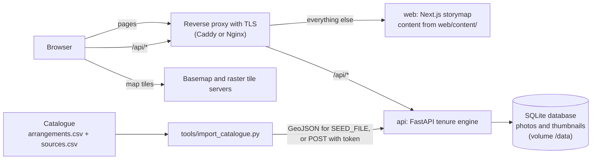

# Water Tenure Storymap

An interactive map and scrollytelling site for publishing a **water tenure assessment**: who uses which water, for what, where, in which season and on what terms, classified on the FAO water tenure typology. It has two parts:

- a **tenure engine**: a small FastAPI service that stores tenure records and geotagged field photos, validates them against a controlled vocabulary, serves them as GeoJSON, statistics and exports, and generalizes the location of sensitive records;
- a **storymap**: a Next.js web app with an interactive map (filterable tenure records, your own vector and raster layers, field photos), chapter-based stories that move the map as the reader opens each section, a picture gallery, a typology page and an About page.

Everything a deployer changes lives in content files (`web/content/`), not in code. The repository ships with a **synthetic example, not real data**: a fictional "Sample River Basin" placed in the open sea near 0 degrees latitude and 0 degrees longitude.

> **How this was made.** This repository was vibe-coded. The code and documentation were written by AI coding agents (Claude Code with Anthropic Claude models, operated as CRPG's agent "Mobot") under the orchestration of Mohamad Mova Al'Afghani, who set the goals, the method and the domain rules and directed and reviewed the work. Treat it as research software: review it before relying on it.

- Live example (CRPG's own deployment, with its own content): https://tenure.crpg.info and https://tenure.crpg.info/story
- Companion skills for producing the catalogue behind the map: https://github.com/movanet/water-tenure-skills
- Indonesian water tenure knowledge base: https://github.com/movanet/know-crpg-tenur

## Screenshots

Screenshots are not included yet. Run the quick start below to see the synthetic sample: a home page with the map, two sample stories, a gallery of placeholder illustrations and the typology page.

## Features

- Tenure records on the map, coloured by tenure type or by the gap between legal and perceived security, with a filter panel (tenure type, use, legal and perceived security, village, irrigation scheme, season) and per-option counts.
- Record popups with security ratings, use, actor, season, confidence grade, source codes, linked photos and a "Read in story" link to the story section that discusses the record.
- Your own map layers from `web/content/layers.json`: GeoJSON as fill, line or circle, coloured by a property, with legends and click popups; raster XYZ or TMS tiles.
- Stories from `web/content/stories/*.json`: chapters and sections with text, pictures and a map camera per section. On phones the map sits above the narrative.
- Shareable map links (view, visible layers, filters) and a basemap picker.
- Tenure engine API: record create, read, update and delete, GeoJSON, typology statistics, CSV and GeoJSON export of public records, vocabulary endpoints, photo upload with EXIF GPS, thumbnails and optional AI captions through any OpenAI-compatible endpoint (off unless configured).
- Data protection by default: records marked `aggregate_only` are published at a deterministically displaced position and left out of exports, photo metadata is stripped, writes need a bearer token. See [docs/DATA-PROTECTION.md](docs/DATA-PROTECTION.md).
- A catalogue importer (`tools/import_catalogue.py`) that turns a water tenure catalogue (`arrangements.csv` + `sources.csv`, the format of the companion skills) into tenure records.

## Quick start with Docker

On a machine with Docker Engine and the Compose plugin:

```bash
git clone https://github.com/movanet/water-tenure-storymap.git
cd water-tenure-storymap
cp .env.example .env
# Edit .env: set TENURE_API_TOKEN (for example: openssl rand -hex 32).
docker compose up -d --build
```

Open http://127.0.0.1:3000. The API answers at http://127.0.0.1:8000/api/health and documents itself at http://127.0.0.1:8000/api/docs. Both ports are bound to 127.0.0.1; to publish the site on a domain with TLS, follow [docs/INSTALL.md](docs/INSTALL.md).

## Quick start without Docker (development)

Requires Python 3.12 or later and Node.js 22 or later.

```bash
# API, seeded with the synthetic sample, data in ./data
python -m venv .venv
. .venv/bin/activate                      # Windows: .venv\Scripts\activate
pip install -r api/requirements.txt
cd api
DATA_DIR=../data SEED_SAMPLE=true TENURE_API_TOKEN=dev-only-token \
  uvicorn app.main:app --host 127.0.0.1 --port 8000
```

```bash
# Web app, in a second terminal; /api/* is proxied to the API
cd web
npm ci
API_INTERNAL_URL=http://127.0.0.1:8000 npm run dev
```

Open http://127.0.0.1:3000.

## Architecture



The web app is built into static pages plus a small Node.js server; the map, the filters and the photos are loaded in the browser from the API. If the API is down, the pages still render and the API-backed layers stay empty.

## Repository layout

| Path | Contents |
|---|---|
| `api/` | Tenure engine (FastAPI): `app/` code, `app/data/tenure_vocab.json` vocabulary, `app/data/sample_tenure_records.geojson` synthetic sample, `tests/` |
| `web/` | Storymap (Next.js 16, React 19, MapLibre, Tailwind CSS 4) |
| `web/content/` | What a deployer edits: `site.json`, `layers.json`, `gallery.json`, `about.md`, `stories/*.json` |
| `web/public/data/sample/`, `web/public/media/sample/` | Synthetic sample layers and placeholder illustrations |
| `tools/` | `import_catalogue.py` (catalogue to records), `make_sample_data.py` (regenerates the synthetic sample), tests and a synthetic catalogue fixture |
| `deploy/` | `Caddyfile.example` |
| `docs/` | Installation, content, API and data protection guides |

## Documentation

- [docs/INSTALL.md](docs/INSTALL.md): deploy on a fresh Ubuntu 24.04 server, DNS, TLS, backups, upgrades.
- [docs/CONTENT.md](docs/CONTENT.md): write your site configuration, layers, stories and gallery; serve your own raster tiles; import a catalogue.
- [docs/API.md](docs/API.md): endpoints with curl examples, authentication, vocabulary and sensitivity rules.
- [docs/DATA-PROTECTION.md](docs/DATA-PROTECTION.md): do-no-harm rules for publishing tenure data.

## Loading your own records

Produce a catalogue (for example with the [water tenure skills](https://github.com/movanet/water-tenure-skills)), then either write a GeoJSON file for seeding an empty database:

```bash
python tools/import_catalogue.py --arrangements arrangements.csv --sources sources.csv \
  --season-map "MT1=wet,MT2=dry1,MT3=dry2" --out records.geojson
```

or post the records to a running API with the token from an environment variable:

```bash
export TENURE_API_TOKEN=...   # the token from your .env
python tools/import_catalogue.py --arrangements arrangements.csv --sources sources.csv \
  --post https://tenure.example.org
```

Rows without coordinates are reported and skipped unless you supply `--centroids`. Quotes, respondent codes and free-text accounts are never exported. The full field map is in [docs/CONTENT.md](docs/CONTENT.md#importing-a-catalogue).

## Tests

```bash
pip install -r api/requirements.txt pytest
python -m pytest api/tests tools/tests     # API, importer, vocabulary sync
cd web && npm ci && npm run lint && npm run build
```

Status of version 1.0.0: the Python tests, the lint and the production build pass, and the pages and API endpoints were checked against a local run of both services. The Docker images were not built during development; `docker compose config` validates the compose file. Please report problems as GitHub issues.

## How to cite

If you use this software, please cite it. `CITATION.cff` holds the same information in machine-readable form.

APA:

> Al'Afghani, M. M. (2026). *Water Tenure Storymap* (Version 1.0.0) [Computer software; vibe-coded with AI agents, orchestrated by the author]. CRPG - Center for Regulation, Policy and Governance. https://github.com/movanet/water-tenure-storymap

BibTeX:

```bibtex
@software{alafghani_2026_water_tenure_storymap,
  author    = {Al'Afghani, Mohamad Mova},
  title     = {Water Tenure Storymap},
  version   = {1.0.0},
  year      = {2026},
  month     = oct,
  publisher = {CRPG - Center for Regulation, Policy and Governance},
  url       = {https://github.com/movanet/water-tenure-storymap},
  license   = {MIT},
  note      = {Vibe-coded with AI coding agents (Claude Code, Anthropic Claude models) under the orchestration of the author}
}
```

## References

The typology and the use codes follow published work:

- FAO (2016). *Exploring the concept of water tenure*. Land and Water Discussion Paper 10. Rome: FAO.
- FAO (2020). *Unpacking water tenure for improved food security and sustainable development*. Rome: FAO.
- FAO (2024). *Water tenure perspectives*. Rome: FAO.
- AlAfghani and Susetyo (2023). *IOP Conference Series: Earth and Environmental Science* 1199, 012016 (water use classification applied in a water tenure assessment).
- AlAfghani, Lee and Yasuda (2025). *Journal of Energy & Natural Resources Law* (water tenure and international norms).

## Contributing and licence

Contributions are welcome; see [CONTRIBUTING.md](CONTRIBUTING.md). Released under the [MIT License](LICENSE), copyright 2026 CRPG - Center for Regulation, Policy and Governance (Mohamad Mova Al'Afghani). Third-party libraries (Next.js, React, MapLibre GL JS, react-map-gl, Tailwind CSS, FastAPI, Pillow and others) are installed from their registries and keep their own licences. Basemap tiles come from third-party providers whose terms of use apply; see [docs/CONTENT.md](docs/CONTENT.md#basemaps).
